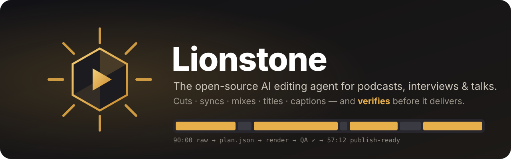
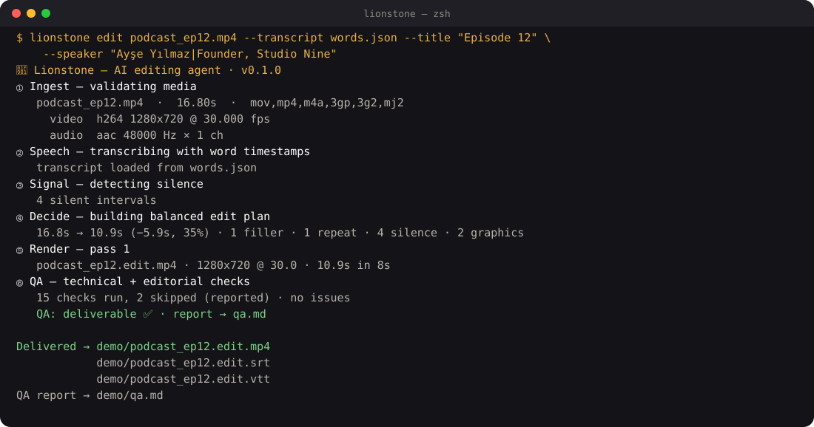
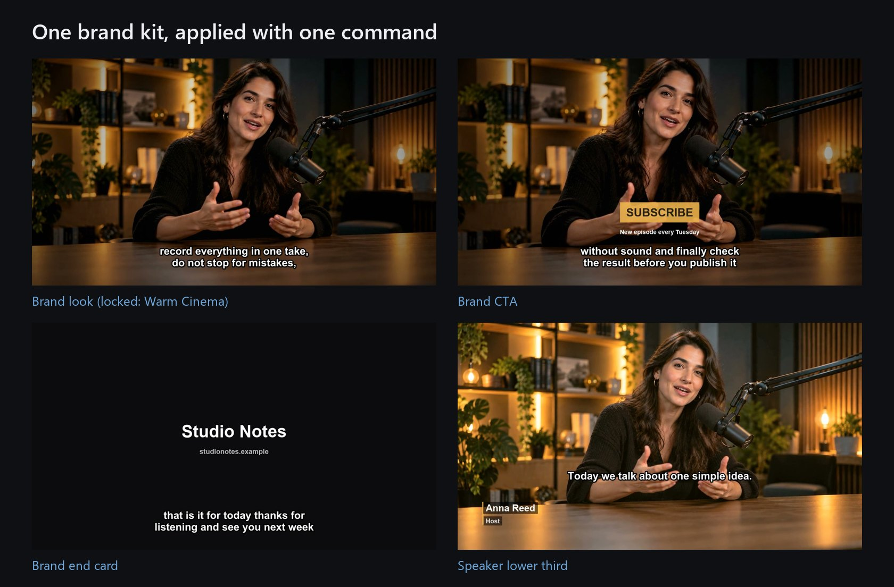
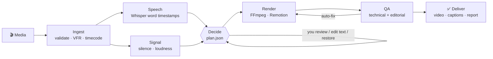

<p align="center">
  
</p>

<p align="center">
  <a href="https://github.com/ismailarslantas/lionstone/actions"></a>
  <a href="LICENSE"></a>
  
  
  
  <a href="https://github.com/ismailarslantas/lionstone/stargazers"></a>
</p>

<p align="center">
  <b>Turn a raw podcast, interview or talk into a publish-ready video — with an edit plan you can read, undo and verify.</b><br>
  Local-first · no upload · no watermark · works offline · <a href="README.tr.md">Türkçe</a>
</p>

---

Most "AI editors" either chop every silence (and your sentences with it) or send your footage to a cloud you don't control. **Lionstone edits like a careful human editor**: it understands the words, keeps meaningful pauses, never cuts inside a word, explains every cut, and **refuses to say "done" until QA has actually checked the file.**

<p align="center">
  
</p>

## ✨ What it does

| | |
|---|---|
| ✂️ **Speech-aware cutting** | Removes fillers (`um`, `uh`, `ııı`, `eee`…), stutters (`the the`), repeated phrases and false starts — keeps breaths and dramatic beats. Three intensities: `natural` · `balanced` · `dynamic`. |
| 🧾 **Explainable, reversible plan** | Every decision lands in `plan.json` with a reason (`filler "um,"`, `pause 2.59s → 0.55s (sentence beat kept)`). Restore any cut with one command. Originals are never touched. |
| 📝 **Edit video by editing text** | Delete a line in `transcript.md` → that sentence is cut. Move lines → scenes reorder. Uncomment → it's back. |
| 🔊 **Broadcast-grade audio** | Two-pass EBU R128 loudness (YouTube −14, podcast −16, broadcast −23 LUFS), true-peak ceiling, de-noise, 8 ms micro-fades at every join (no clicks). |
| 🎨 **Color & look** | Auto-exposure, tasteful looks (`natural`, `warm`, `film`, `punchy`…), your own `.cube` LUT. |
| 🔤 **Titles, lower thirds, captions** | 6 free title effects, SRT/VTT/ASS captions, burned-in captions that move out of the way of lower thirds. Turkish casing (`i → İ`) and right-to-left scripts handled. |
| ✅ **QA before delivery** | Full decode, A/V length, black/frozen frames, loudness + true peak, clicks at every join, word-clipping, caption timing, graphics overlap/readability. **Skipped checks are reported as skipped — never as passed.** Auto-fixes what it can, then re-checks. |
| 🤖 **Agent-ready** | Built-in **MCP server**: let Claude, Cursor or any MCP client plan, review and render edits for you. |
| 🧩 **Plugin system** | Effects, commands, exporters, QA hooks, caption styles and reframers are all plugins. |

## 🚀 Quick start

```bash
# 1. FFmpeg (5+) — any build works; titles/burned captions need libfreetype + libass
sudo apt install ffmpeg                  # Ubuntu / Debian (full build)
winget install ffmpeg                    # Windows (full build)
conda install -c conda-forge ffmpeg      # macOS / anywhere (full build)
# brew install ffmpeg also works; if `lionstone doctor` reports drawtext/subtitles
# missing, Lionstone still edits but skips titles & burn-in (and says so in qa.md)

# 2. Lionstone (+ local Whisper transcription)
pip install "lionstone[whisper] @ git+https://github.com/ismailarslantas/lionstone"

# 3. Edit
lionstone edit podcast.mp4 --title "Episode 12" --speaker "Ayşe Yılmaz|Founder"
```

You get, in `podcast_lionstone/`:

```
podcast.edit.mp4    ← the edited video
podcast.edit.srt    ← captions (also .vtt)
plan.json           ← every cut / title / setting, with reasons
transcript.md       ← edit-by-text file
qa.md · qa.json     ← what was checked, what passed, what needs a human
```

Check your setup any time with `lionstone doctor`.

### 📚 Step-by-step guides (with real screenshots)

| | Guide | You'll learn |
|---|---|---|
|  | **[Your first video](docs/guides/free.md)** | install, one-command edit, captions, reading the QA report, editing by text, restoring cuts |
|  | **[Creative features](docs/guides/pro.md)** | the agent, looks / transitions / animated text, previews, Shorts & Reels, Resolve / Final Cut / Premiere export |
|  | **[Team tools](docs/guides/studio.md)** | roles per person, brand kits, locked presets with history, batch apply for a season |

## 🧭 How it works



**Deciding is separate from rendering.** Agents write structured decisions into a plain-JSON plan; the renderer only executes it. That's what makes edits explainable, diffable and undoable — and lets an LLM agent work on the plan instead of on pixels.

## 🎛️ Everyday commands

```bash
lionstone plan  talk.mp4 --intensity dynamic      # analyze only → plan.json + transcript.md
lionstone cuts  talk_lionstone/plan.json          # list every cut with its reason
lionstone cuts  talk_lionstone/plan.json --restore c0004 c0011   # undo specific cuts
lionstone apply-transcript talk_lionstone/plan.json talk_lionstone/transcript.md
lionstone render talk_lionstone/plan.json         # render + QA
lionstone qa    any_video.mp4                     # QA any file
lionstone effects list --style cinematic          # browse effects 
lionstone effects preview F03 --text "Chapter 2" --gif
```

<details>
<summary><b>All edit options</b></summary>

```
--intensity natural|balanced|dynamic   --profile youtube|podcast|social|broadcast
--aspect 16:9|9:16|1:1|4:5             --reframe center|face (needs OpenCV)
--title / --subtitle / --outro         --speaker "Name|Title[|SPEAKER_00]" (repeatable)
--chapter "00:12:30 Pricing"           --title-effect F01 … --lower-third-effect F05
--captions burn|file|none              --caption-style clean|bold|social
--color natural|warm|cool|punchy|film  --lut my.cube    --denoise off|light|strong
--model small|medium|large-v3          --language tr    --transcript words.json   --no-asr
--renderer auto|ffmpeg|remotion        --fast           --x key=value (plugins)
```
</details>

## 🎞️ Effect library

Every effect is a JSON definition (timing, parameters, constraints, license tier, fallback) + a **Remotion** component (reference look, alpha channel) + a native **FFmpeg** renderer (zero-dependency fallback). If an effect can't render, its declared fallback runs and the report says so.

| Classic | | | Premium | | |
|:-:|:-:|:-:|:-:|:-:|:-:|
| <br>**F01** Cinematic Fade | <br>**F02** Slow Rise | <br>**F03** Line Reveal | <br>**P01** Light Sweep | <br>**P02** Footage Mask | <br>**P03** Depth Parallax |
| <br>**F04** Chapter Card | <br>**F05** Lower Third | <br>**F06** Letter Spacing | <br>**P04** Film Grain | <br>**P05** Kinetic Words | <br>**P06** Brand Reveal |

Default placement rules (all overridable): opening → Cinematic Fade · new chapter → Chapter Card · first time a speaker talks → Lower Third · normal speech → **no effect** (choosing no effect is a valid edit) · closing → fade. Never two animated titles at once; captions move up while a lower third is on screen; always long enough to read; Pro effects are never auto-applied. (Pro's vision QA also checks that graphics don't cover faces.)

Remotion titles: `cd remotion && npm install` once — Lionstone picks it up automatically (`--renderer auto`).

## 🤖 Use it from Claude / Cursor (MCP)

```bash
pip install "lionstone[mcp,whisper] @ git+https://github.com/ismailarslantas/lionstone"
```

```json
{ "mcpServers": { "lionstone": { "command": "lionstone", "args": ["mcp"] } } }
```

Then just ask: *"Edit ~/Videos/ep12.mp4 for YouTube, keep it natural, introduce Ayşe as Founder, and show me any cut you're unsure about."* The agent gets tools to `plan_edit`, read/`edit_transcript`, `restore_cuts`, `render_plan` and read the QA verdict — it can't claim success unless QA says `deliverable: true`.

## 💎 Everything is free

Lionstone is a complete editor and **every feature is free and open source (Apache-2.0)**: no license key, no account, no watermark, no upload, no telemetry. The former Pro and Studio features are part of the core.

| Feature | Command |
|---|---|
| Speech-aware cutting, edit by text, restore cuts, plan.json | `lionstone edit` · `plan` · `apply-transcript` |
| Loudness, de-noise, color, LUTs, captions, RTL, Turkish | `lionstone edit` |
| 12 title effects (F01-F06 + P01-P06) and 12 animated text presets | `lionstone effects list` |
| **Creative Suite**: 133 looks, effects, transitions, motion and text presets with previews, keyframes and an agent that picks them | `lionstone fx list` · `fx preview` · `fx auto` |
| **Multicam**: audio sync with drift check, active-speaker switching | `lionstone multicam` |
| **Style learning** from 1-3 reference videos | `lionstone style learn` |
| **Shorts/Reels generator**: best moments → 9:16, face-tracked reframe, hook titles | `lionstone clips` |
| **Project export**: FCPXML (Resolve / Final Cut) + EDL (Premiere) | `lionstone export` |
| **Team tools**: brand kits, roles, versioned and locked presets, batch apply | `lionstone team` · `brand` · `preset` · `fx batch` |
| **Vision QA**: graphics/captions covering faces | `pip install "lionstone[vision]"` |
| **Lionstone Styles**: codes like `O4 W3 A3 G5 S4 P3` that map to real edit options | `lionstone styles --open` · `--cmd O4 W3 A3` |

Install everything with `pip install "lionstone[all] @ git+https://github.com/ismailarslantas/lionstone"`. Details: [docs/PRO.md](docs/PRO.md) and the [guides](docs/guides/pro.md).

## 🗺️ Roadmap

See [ROADMAP.md](ROADMAP.md). Next up: speaker diarization in the free tier, segment-level re-render, browser review UI (player + transcript + timeline), filler detection without ASR, more languages for filler lexicons.

## 🤝 Contributing

PRs welcome — especially filler lexicons for your language, new free effects, and QA checks. Start with [CONTRIBUTING.md](CONTRIBUTING.md); AI coding agents should read [AGENTS.md](AGENTS.md).

```bash
git clone https://github.com/ismailarslantas/lionstone && cd lionstone
pip install -e ".[dev,whisper]" && pytest
```

## 📄 License

Everything: [Apache-2.0](LICENSE). Effect assets ship with OFL/system fonts only — check the license of any font, LUT or footage you add.

<p align="center"><sub>Built in İzmir by <a href="https://www.linkedin.com/in/ismailarslantas/">İsmail Arslantaş</a> · If Lionstone saved you an evening of editing, a ⭐ helps others find it.</sub></p>
