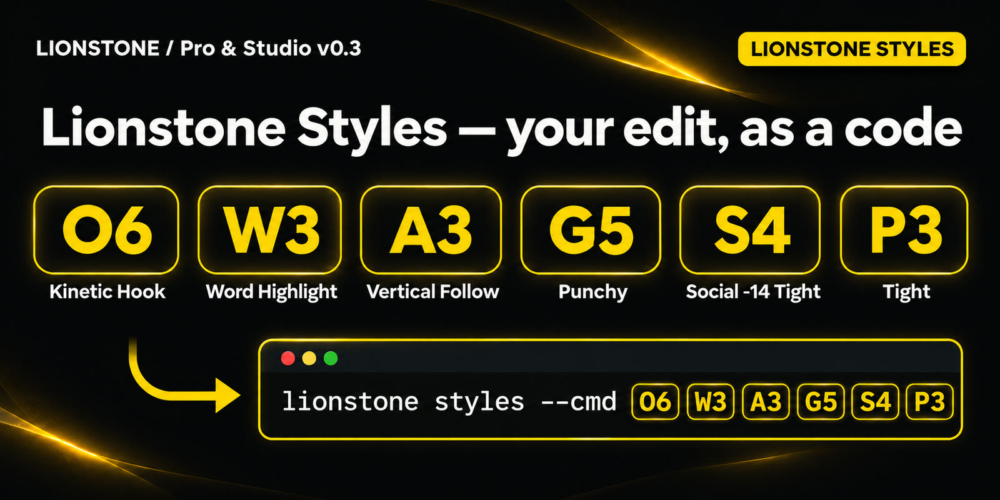
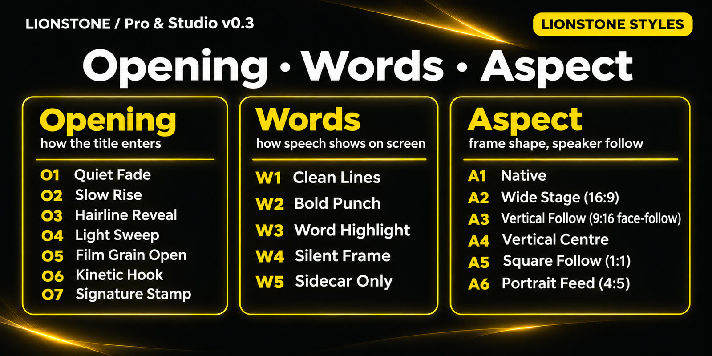
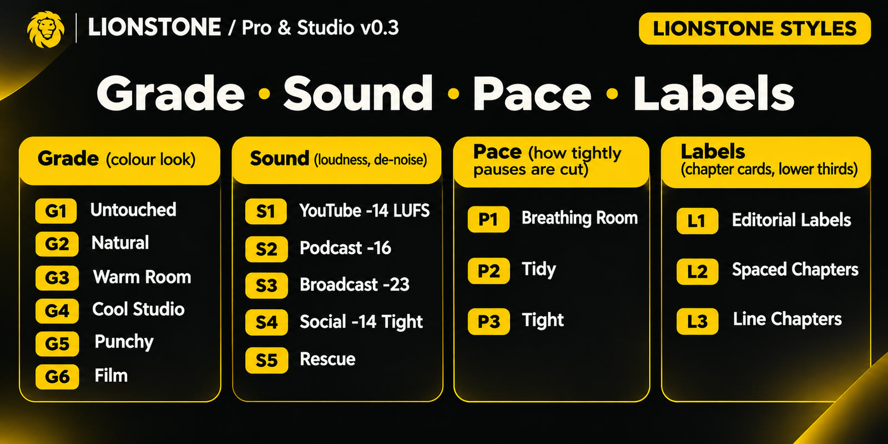

# Lionstone Pro & Studio — feature guide

Lionstone Pro & Studio (v0.3.0 and v0.3.1) is one free, open-source package under Apache-2.0.
There are no license keys, no activation, no watermarks and no locked presets: every feature below
is available to everyone, individuals and teams alike.

**Step-by-step guides:** [your first video](guides/first-video.md) · [creative features](guides/creative-features.md) · [team tools](guides/team-tools.md)

## What you get

| Command / feature | What it does |
|---|---|
| `lionstone multicam` | Syncs 2+ cameras and isolated mics on audio (coarse onset match + sample-accurate refine), re-checks sync mid-way and at the end to catch clock drift, gates mic bleed, then cuts to the active speaker with minimum shot length, hysteresis, crosstalk → wide shot and long-monologue cutaways. Never assigns footage a camera didn't record. |
| `lionstone style learn ref1.mp4 ref2.mp4` | Builds a reusable style profile: cut rhythm, pause behaviour → intensity, loudness profile, color (contrast / saturation / warmth). Apply with `--x style=style.json`, choose traits with `--x style_apply=tempo,color`. |
| `lionstone clips plan.json -n 5` | Finds self-contained moments (complete sentences, strong first line, good pace), renders 9:16 with face-tracked reframing, a kinetic hook title and word-highlight captions. `--llm` re-ranks with your own Claude API key. |
| `lionstone export plan.json` | FCPXML 1.10 (DaVinci Resolve, Final Cut Pro) + CMX3600 EDL (Premiere Pro). Clips point at your original media, multicam included. |
| `lionstone variants talk.mp4` | Natural / Cinematic / Dynamic plans from one analysis, compared side by side. |
| Effects P01–P06 | Light Sweep, Footage Mask Reveal, Depth Parallax, Film Grain, Staggered Kinetic, Signature Brand Reveal — Remotion quality, FFmpeg fallbacks for P03–P06. |
| Vision QA | Flags lower thirds, titles or captions that cover a face. |
| `--reframe face` | Face-following crop for 9:16 / 1:1 / 4:5. |

## Creative Suite

Original Lionstone looks, effects, transitions, motion and animated text — previewed before you commit and rendered with the exact same code.

| Command | What it does |
|---|---|
| `lionstone fx list --kind look` · `lionstone fx show soft-bloom` | Browse 133 presets with tier, status, cost and licence. Favourites and search included. |
| `lionstone fx preview soft-bloom --before-after --gif` | Real low-res preview with the export builders; every preset previews and renders. |
| `lionstone fx apply plan.json dip-to-black --join 2` | Put a look, effect, transition or motion preset on the whole video, a segment, a cut or a source range. Keyframes with 6 easing curves. |
| `lionstone fx text plan.json counter-up --text "Customers" --at 12 --param to=250` | 25 animated text presets — Word Pop, Counter Up, Price Reveal, Stat, Location/Speaker labels, CTA, Type-on, End Card — plus karaoke captions. |
| `lionstone fx auto plan.json --content vlog --style social` | Lionstone Agent picks one consistent look, emphasis zooms and transitions on real topic changes, within budgets — with a reason for every decision. |
| `lionstone fx render plan.json` | Compile + render + QA (flash limit ≤ 3/s, exposure, saturation, stale-edit check). |
| `lionstone fx apply plan.json stage-light --source 0-3.5` · `lionstone fx showcase stage-light talk.mp4` | **Reel FX Pack**: 12 one-command effects for Reels & Shorts (stage-light, press-mono, frost-panels, duotone-pop, scan-line, afterimage, halo-orbit, neon-outline, insight-split, brand-frame, progress-rail, pixel-resolve) and 6.4 s showcase reels. Guide: [reel-fx.md](reel-fx.md). |

Features that aren't finished yet (two-clip cross dissolves, particles, subject masking) are listed as **planned** in the catalog — never shipped as buttons that do nothing. Text presets need an FFmpeg build with `drawtext`; on builds without it (e.g. Homebrew's default), Lionstone skips them with a clear message.

### Team tools

| Command | What it does |
|---|---|
| `lionstone whoami ed@acme.com` | Each person on the shared Studio key works under their own email; roles follow it. |
| `lionstone team init "ACME"` · `lionstone team member ed@acme.com editor` | Roles: viewer, editor, admin, owner — in a shared folder or git repo. Nothing is uploaded. |
| `lionstone preset save "ACME Warm" --from look-warm-cinema --team --locked` | Versioned team presets with history and revert; locked company presets only admins can change. |
| `lionstone brand create kit.json --team` · `lionstone brand apply plan.json ACME` | Brand kits: colors, licensed fonts, logo, lower third, CTA, end card, signature look and transition. |
| `lionstone fx batch dip-to-black projects/*/plan.json --anchor all-joins` | Apply the same look or transition to a whole season. |

## Install

```bash
pip install "lionstone[all] @ git+https://github.com/ismailarslantas/lionstone"
```

NumPy is needed for multicam, style learning, clips and the creative presets; OpenCV for face
features (`lionstone[vision]`). Remotion-quality P01-P06 need Node.js 18+ and `cd remotion && npm ci`
in a source checkout; without it P03-P06 render with their FFmpeg versions and P01/P02 fall back to F01.

## Lionstone Styles






`lionstone styles` lists style codes (`O4 W3 A3 G5 S4 P3`) that map to real edit options.
`lionstone styles --cmd O4 W3 A3` prints the edit command, `--open` shows the visual guide, and
`integrations/lionstone-styles` is a Claude skill that edits with them.

## Upgrading from the separate `lionstone-pro` package

If you installed `lionstone-pro`, uninstall it (`pip uninstall lionstone-pro`): the same features are
now in `lionstone`. `lionstone pro activate/status/renew` no longer exist; `lionstone pro whoami` became
`lionstone whoami`. Any license key you bought keeps your thanks, not a restriction.
