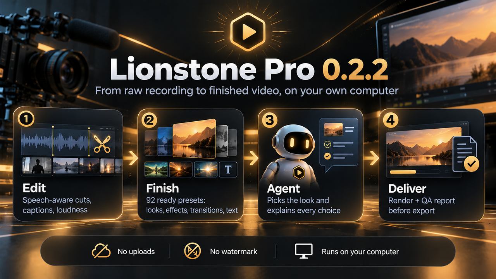
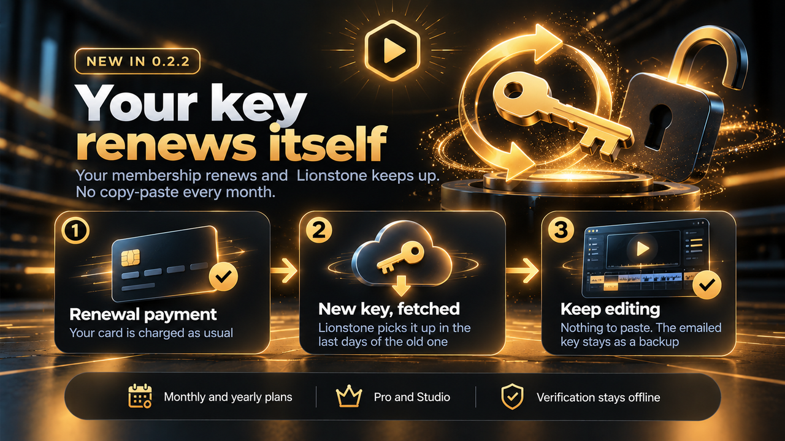
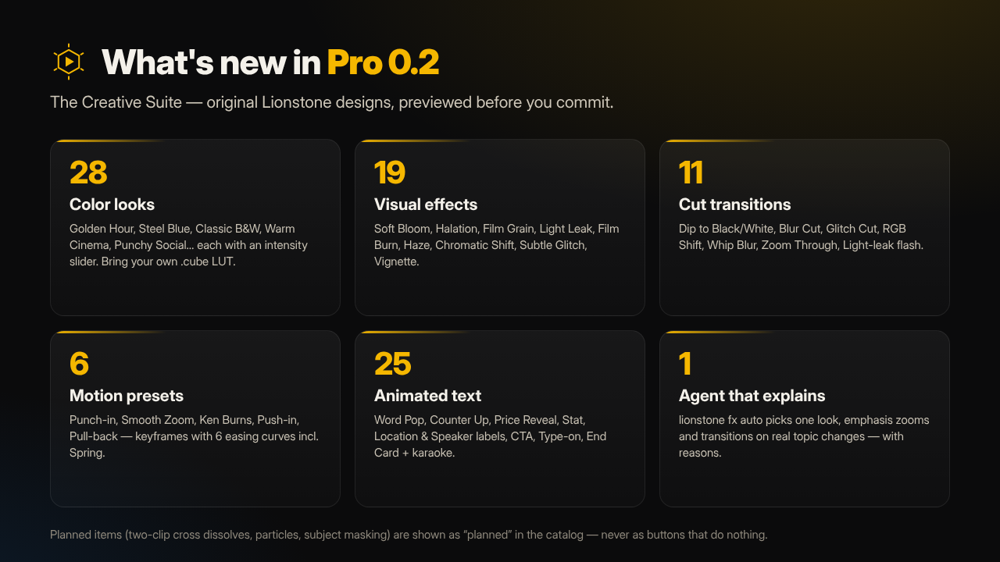
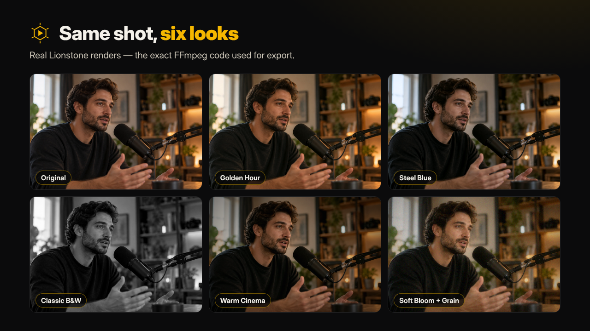
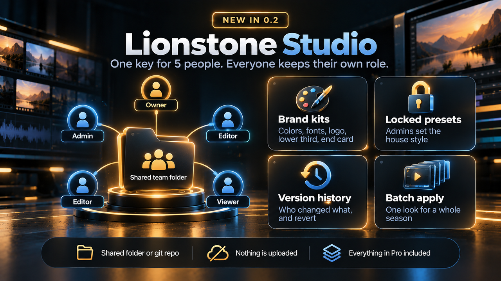

# Lionstone Pro & Studio


Pro is a plugin for the open-source core. Install it next to `lionstone`, activate your key, and the extra commands and effects unlock. Everything still runs locally.

| Plan | For | Price* |
|---|---|---|
| **Pro** | creators and editors who publish every week (1 person) | $12 / month · $99 / year |
| **Studio** | agencies & teams: everything in Pro plus brand kits, roles, versioned team presets and batch apply — 5 people | $39 / month · $349 / year |

Both plans include an illustrated installation guide (PDF) for Windows, macOS and Linux.

<sub>*Launch pricing. Students, non-profits and open-source maintainers: ask for a free key.</sub>

Memberships renew automatically, and so does your key: each key is valid for the paid month or year plus 7 days, and in its last days Lionstone (0.2.2+) fetches the next one by itself. The new key is also emailed as a backup. If you cancel, your last key keeps working until it expires.

**→ [Buy Lionstone Pro](https://aidijitalakademi.gumroad.com/l/lionstone-pro) · [Buy Lionstone Studio](https://aidijitalakademi.gumroad.com/l/lionstone-studio)**



**Step-by-step guides with real screenshots:** [your first video (free)](guides/free.md) · [finishing with Pro](guides/pro.md) · [teams with Studio](guides/studio.md)

## New in 0.2.1 – 0.2.3

| Version | What changed |
|---|---|
| **0.2.3** | Brand kits accept the documented `{"preset": …}` form for transitions and lower thirds; on short videos the brand CTA no longer pushes out the end card. |
| **0.2.2** | Keys renew themselves near the end of each period (`lionstone pro renew` checks now; `LIONSTONE_NO_RENEW=1` turns it off). |
| **0.2.1** | Studio: everyone on a shared key works under their own email (`lionstone pro whoami you@team.com`), so roles tell members apart. Windows: no more errors when output is redirected. |



## What you get

| Command / feature | What it does |
|---|---|
| `lionstone multicam` | Syncs 2+ cameras and isolated mics on audio (coarse onset match + sample-accurate refine), re-checks sync mid-way and at the end to catch clock drift, gates mic bleed, then cuts to the active speaker with minimum shot length, hysteresis, crosstalk → wide shot and long-monologue cutaways. Never assigns footage a camera didn't record. |
| `lionstone style learn ref1.mp4 ref2.mp4` | Builds a reusable style profile: cut rhythm, pause behaviour → intensity, loudness profile, color (contrast / saturation / warmth). Apply with `--x style=style.json`, choose traits with `--x style_apply=tempo,color`. |
| `lionstone clips plan.json -n 5` | Finds self-contained moments (complete sentences, strong first line, good pace), renders 9:16 with face-tracked reframing, a kinetic hook title and word-highlight captions. `--llm` re-ranks with your own Claude API key. |
| `lionstone export plan.json` | FCPXML 1.10 (DaVinci Resolve, Final Cut Pro) + CMX3600 EDL (Premiere Pro). Clips point at your original media, multicam included. |
| `lionstone variants talk.mp4` | Natural / Cinematic / Dynamic plans from one analysis, compared side by side. |
| Pro effects P01–P06 | Light Sweep, Footage Mask Reveal, Depth Parallax, Film Grain, Staggered Kinetic, Signature Brand Reveal — Remotion quality, FFmpeg fallbacks for P03–P06. |
| Vision QA | Flags lower thirds, titles or captions that cover a face. |
| `--reframe face` | Face-following crop for 9:16 / 1:1 / 4:5. |

## New in 0.2 — Creative Suite (Pro & Studio)



Original Lionstone looks, effects, transitions, motion and animated text — previewed before you commit and rendered with the exact same code.

| Command | What it does |
|---|---|
| `lionstone fx list --kind look` · `lionstone fx show soft-bloom` | Browse 133 presets with tier, status, cost and licence. Favourites and search included. |
| `lionstone fx preview soft-bloom --before-after --gif` | Real low-res preview with the export builders; locked presets preview with a watermark. |
| `lionstone fx apply plan.json dip-to-black --join 2` | Put a look, effect, transition or motion preset on the whole video, a segment, a cut or a source range. Keyframes with 6 easing curves. |
| `lionstone fx text plan.json counter-up --text "Customers" --at 12 --param to=250` | 25 animated text presets — Word Pop, Counter Up, Price Reveal, Stat, Location/Speaker labels, CTA, Type-on, End Card — plus karaoke captions. |
| `lionstone fx auto plan.json --content vlog --style social` | Lionstone Agent picks one consistent look, emphasis zooms and transitions on real topic changes, within budgets — with a reason for every decision. |
| `lionstone fx render plan.json` | Compile + render + QA (flash limit ≤ 3/s, exposure, saturation, stale-edit check). |



Features that aren't finished yet (two-clip cross dissolves, particles, subject masking) are listed as **planned** in the catalog — never shipped as buttons that do nothing. Text presets need an FFmpeg build with `drawtext`; on builds without it (e.g. Homebrew's default), Lionstone skips them with a clear message.

### Studio: team tools



| Command | What it does |
|---|---|
| `lionstone pro whoami ed@acme.com` | Each person on the shared Studio key works under their own email; roles follow it. |
| `lionstone team init "ACME"` · `lionstone team member ed@acme.com editor` | Roles: viewer, editor, admin, owner — in a shared folder or git repo. Nothing is uploaded. |
| `lionstone preset save "ACME Warm" --from look-warm-cinema --team --locked` | Versioned team presets with history and revert; locked company presets only admins can change. |
| `lionstone brand create kit.json --team` · `lionstone brand apply plan.json ACME` | Brand kits: colors, licensed fonts, logo, lower third, CTA, end card, signature look and transition. |
| `lionstone fx batch dip-to-black projects/*/plan.json --anchor all-joins` | Apply the same look or transition to a whole season. |

## Activate

```bash
pip install "lionstone-pro @ <private download link from your receipt>"
lionstone pro activate LSP1.xxxxx.yyyyy   # Studio keys start with LSS1.
lionstone pro status
lionstone pro setup-remotion   # optional, needs Node.js 18+: Remotion-quality P01–P06
```

Without `setup-remotion`, P03–P06 render with their FFmpeg versions and P01/P02 fall back to F01.
It installs into your user data folder (`%LOCALAPPDATA%\lionstone\pro-remotion` on Windows,
`~/.local/share/lionstone/pro-remotion` elsewhere). Before `pip uninstall lionstone-pro`, run
`lionstone pro remove-remotion` to delete it.

Servers / CI: set `LIONSTONE_LICENSE` instead of activating. Keys are verified offline (Ed25519 signatures); there is no telemetry.

Renewals (Pro 0.2.2+): in the last 7 days of a monthly or yearly key, Lionstone asks the license server at most once a day for the next period's key and activates it, so you don't have to paste it. It sends only your current key. `lionstone pro renew` checks right away; `LIONSTONE_NO_RENEW=1` turns it off (renewal keys still arrive by email).
