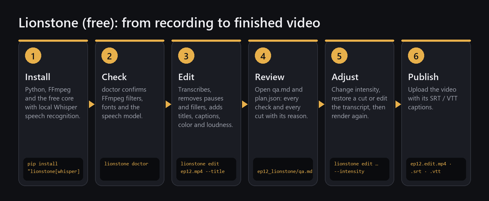
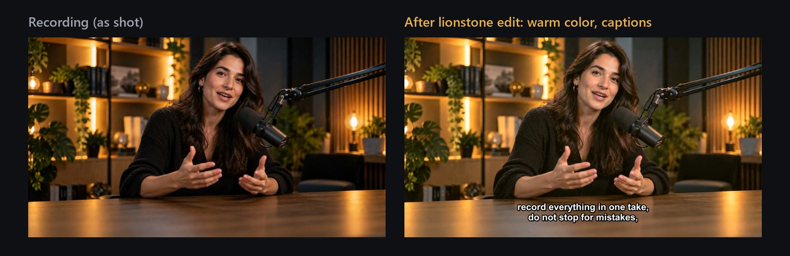
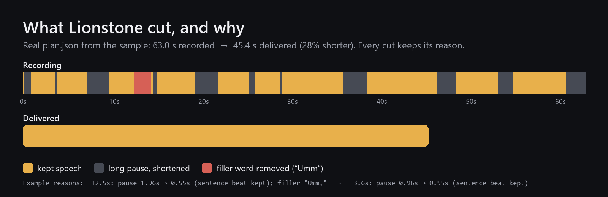
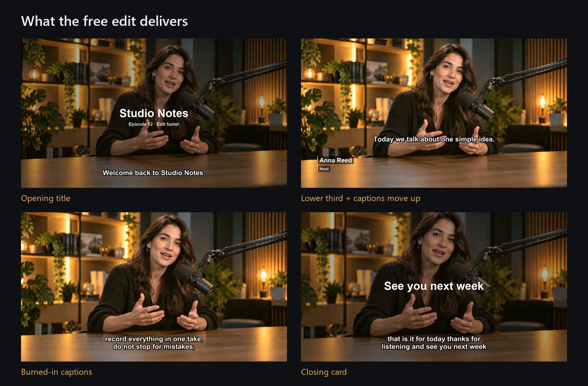

# Your first video with Lionstone (free)

From a raw recording to a finished, captioned video, step by step. Everything in this guide is real:
the screenshots and outputs come from editing the sample episode below with Lionstone 0.1 on Windows.
The same commands work on macOS and Linux.



**You'll end up with:** an edited video without long pauses or filler words, an opening title, a
speaker lower third, burned-in captions plus `.srt` / `.vtt` files, broadcast-safe loudness, a closing
card and a QA report that tells you whether the file is safe to publish.

**Time:** about 15 minutes the first time (installing), then one command per episode.

---

## The sample episode

A 63-second podcast intro, recorded in one take: a host talking to camera, with long pauses, an
"um" and an "uh" — exactly what a real first take looks like.



---

## Step 1 — Install

You need Python 3.10+, FFmpeg and Git. Pick your system:

| Windows (PowerShell) | macOS (Terminal) | Linux (Ubuntu/Debian) |
|---|---|---|
| `winget install Python.Python.3.12` | `brew install python@3.12 ffmpeg git` | `sudo apt install python3 python3-venv ffmpeg git` |
| `winget install Gyan.FFmpeg` | | |
| `winget install Git.Git` | | |

Close the terminal and open a new one, then create a workspace and install Lionstone with local
speech recognition:

```bash
python -m venv lionstone-env
# Windows: lionstone-env\Scripts\Activate.ps1      macOS/Linux: source lionstone-env/bin/activate
pip install "lionstone[whisper] @ git+https://github.com/ismailarslantas/lionstone"
```

> Speech recognition runs on your computer with [faster-whisper](https://github.com/SYSTRAN/faster-whisper).
> The first edit downloads the speech model once (about 150 MB for `base`). Nothing else leaves your machine.

## Step 2 — Check your setup

```bash
lionstone doctor
```

```text
🦁 Lionstone — AI editing agent · v0.3.0
  ✅ ffmpeg             ffmpeg version 9.0.2-full_build …
  ✅   filter drawtext  available
  ✅   filter subtitles available
  ✅   filter loudnorm  available
  ✅   filter ebur128   available
  ✅   filter afftdn    available
  ✅   filter lut3d     available
  ✅ faster-whisper     installed
  ✅ title font         C:/Windows/Fonts/arialbd.ttf
  ✅ node (Remotion)    C:\Program Files\nodejs\node.EXE
  ✅ tiers              free, pro, studio
  ✅ plugin builtin     ok
```

Every line should be ✅. A ❌ next to a filter means your FFmpeg build lacks it; Lionstone still edits
and tells you what it skipped (for example titles without `drawtext`).

## Step 3 — Edit with one command

```bash
lionstone edit ep12.mp4 --model base --language en \
  --title "Studio Notes" --subtitle "Episode 12 · Edit faster" \
  --speaker "Anna Reed|Host" \
  --captions burn --color warm --profile podcast \
  --outro "See you next week"
```

What each part does:

| Option | Effect |
|---|---|
| `--model base --language en` | speech recognition model and language (`tr`, `de`, … also work; leave `--language` out to auto-detect) |
| `--title`, `--subtitle` | opening title card |
| `--speaker "Name\|Title"` | lower third the first time this person speaks |
| `--captions burn` | captions burned into the picture, plus `.srt` and `.vtt` files (`file` = files only) |
| `--color warm` | color correction: `natural`, `warm`, `cool`, `punchy`, `film` |
| `--profile podcast` | loudness target: podcast −16 LUFS (`youtube`, `social`: −14, `broadcast`: −23) |
| `--outro` | closing card |

The real output:

```text
① Ingest — validating media
   ep12.mp4  ·  63.04s  ·  1280x720 @ 25 fps · aac 48 kHz
② Speech — transcribing with word timestamps
   faster-whisper/base: 84 words in 4s
③ Signal — detecting silence
   22 silent intervals
④ Decide — building balanced edit plan
   63.0s → 45.4s (−17.6s, 28%) · 1 mixed · 11 silence · 3 graphics
⑤ Render — pass 1
   ep12.edit.mp4 · 1280x720 @ 25.0 · 45.5s in 21s
⑥ QA — technical + editorial checks
   16 checks run, 2 skipped (reported) · no issues
   QA: deliverable ✅ · report → qa.md
```

Lionstone works in a fixed order: it **validates** the file, **transcribes** it word by word,
**finds silences**, **decides** what to cut (writing every decision to `plan.json`), **renders**, and
finally **checks** the result. Deciding and rendering are separate, so every edit can be explained,
undone and re-rendered.



Pauses are shortened, not removed completely: a short "sentence beat" is kept so the speech still
breathes. The "Umm" was cut together with the pause around it.

### What you get

```text
ep12_lionstone/
  ep12.edit.mp4     ← the finished video
  ep12.edit.srt     ← captions (also .vtt)
  plan.json         ← every cut and graphic, with its reason
  transcript.md     ← edit the video by editing this text
  qa.md             ← the QA report
```



The lower third appears the first time Anna speaks, and the captions move up while it is on screen,
so the two never overlap.

## Step 4 — Read the QA report before you publish

`qa.md` lists every check. Excerpt from the sample:

| | Check | Result |
|---|---|---|
| ✅ | `av_length` | video/audio length difference 20 ms |
| ✅ | `loudness` | −16.0 LUFS (target −16.0 ±1.0) |
| ✅ | `join_clicks` | inspected 11/11 joins, 0 suspicious |
| ✅ | `word_integrity` | 12 cuts verified against 84 word timestamps |
| ✅ | `caption_timing` | 11 cues inside timeline, 0 overlaps |
| ✅ | `graphics_rules` | 3 graphics · overlaps 0 · too short 0 |

**Deliverable: yes** means the file passed. If something is wrong, QA says what and where — for
example, our first test recording had a picture 2 seconds longer than its sound, and QA blocked it:

```text
🛑 critical  av_length  audio and video lengths differ by 2.02s
```

Skipped checks are listed as skipped, never counted as passed.

## Step 5 — Adjust (optional)

**Cut a sentence by deleting it from the text.** Open `transcript.md`:

```text
[t0001 00:00:01.0] Welcome back to Studio Notes.
[t0002 00:00:03.9] I am Anna, and this is episode 12.
[t0003 00:00:09.7] Today we talk about one simple idea.
…
```

Delete a line (or move lines to reorder), then apply and render:

```bash
lionstone apply-transcript ep12_lionstone/plan.json ep12_lionstone/transcript.md
# Applied: 1 sentences cut, 0 cuts restored. New length 35.7s.
lionstone render ep12_lionstone/plan.json
```

**Undo a single cut.** `lionstone cuts` lists every cut with its reason:

```text
id     on     source        len  kind     reason
c0002  ✓   7.22–9.64      2.42s  silence  pause 2.99s → 0.55s (sentence beat kept)
c0003  ✓  12.46–14.35     1.89s  mixed    pause 1.96s → 0.55s (sentence beat kept); filler "Umm,"
x0006  ✓  25.60–37.43    11.83s  transcript  sentence t0006 deleted in transcript
```

```bash
lionstone cuts ep12_lionstone/plan.json --restore c0003   # bring the "Umm" back
lionstone render ep12_lionstone/plan.json                 # render + QA again
```

**Tighter or looser cutting:** add `--intensity natural` (gentle) or `--intensity dynamic` (fast, social)
to `lionstone edit`.

> Whisper writes what it hears. If a name comes out wrong in the captions, fix it in the `.srt` file
> before uploading, or use `--transcript words.json` with your own word timestamps.

## Step 6 — Publish

Upload `ep12.edit.mp4`. For YouTube, also upload `ep12.edit.srt` as the caption track so viewers can
switch captions on and off (use `--captions file` if you don't want them burned in).

---

## Every episode after this

```bash
lionstone edit next-episode.mp4 --title "Studio Notes" --subtitle "Episode 13" --speaker "Anna Reed|Host" --captions burn
```

## Use it from Claude or Cursor

Lionstone ships an MCP server: `lionstone mcp`. Ask your assistant *"Edit ep12.mp4 for YouTube, keep
it natural, and show me any cut you're unsure about"* — it plans, edits the transcript, restores cuts
and renders, and it can only report success when QA says `deliverable: true`.
See [examples/README.md](../../examples/README.md).

## Want more?

The [creative features](pro.md) are part of Lionstone too, and free: looks, effects, transitions,
animated text, an agent that picks them and explains why, Shorts & Reels, multicam and
Resolve / Final Cut / Premiere export. The [team guide](studio.md) covers brand kits and roles.
→ [Feature overview](../PRO.md)
