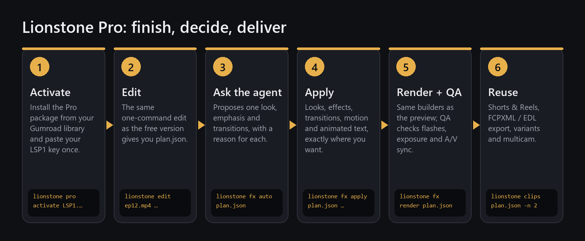
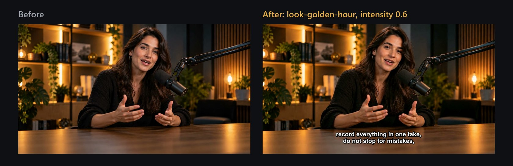
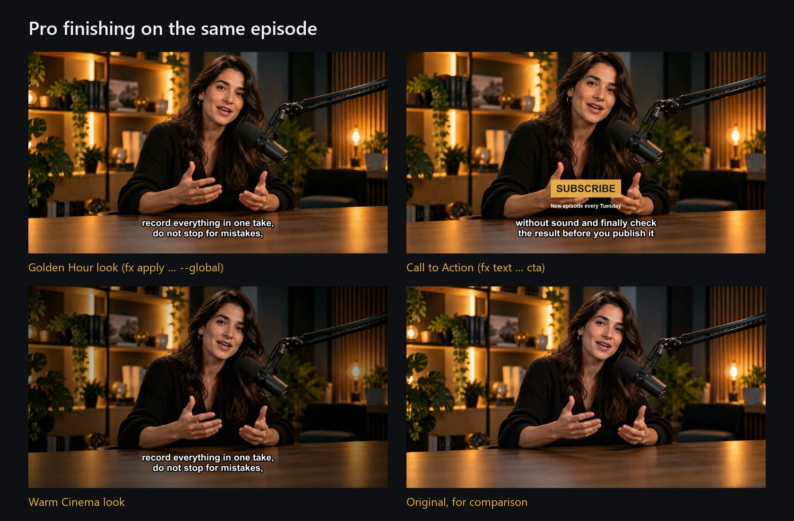
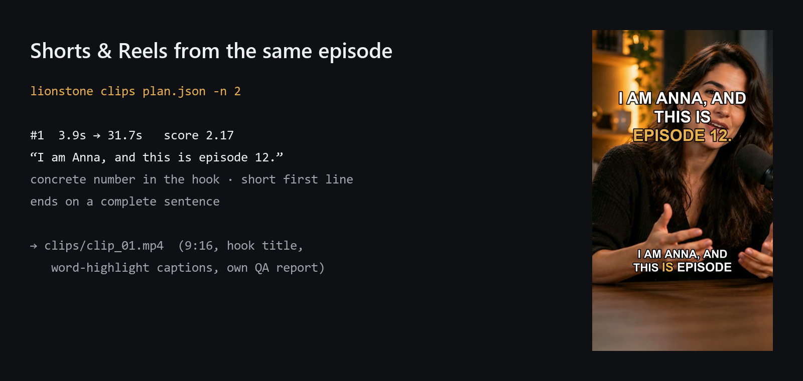

# Finishing a video: the creative features

Lionstone's creative features take the edit from the [free guide](free.md) and finishes it: a consistent look,
transitions, animated text, an agent that proposes all of it and explains why, then Shorts & Reels
and project files for your editing software. Everything below is a real run on the same sample
episode. They are free and open source, like the rest of Lionstone.



---

## Step 1 — Install

Nothing to buy and nothing to activate. With the core installed
([free guide, step 1](free.md#step-1--install)), add NumPy (and OpenCV for face-following crops):

```bash
pip install "lionstone[extras] @ git+https://github.com/ismailarslantas/lionstone"
# face-following reframe and vision QA:
pip install "lionstone[vision] @ git+https://github.com/ismailarslantas/lionstone"
```

`lionstone doctor` shows what is available.

## Step 2 — Edit as usual

Same command as before; the creative features add to it, they don't replace it:

```bash
lionstone edit ep12.mp4 --title "Studio Notes" --speaker "Anna Reed|Host" --captions burn --profile podcast
```

This gives you `ep12_lionstone/plan.json`, the file every `fx` command below works on.

## Step 3 — Ask the agent

Not sure what fits? Let Lionstone propose it. `--dry-run` shows the proposal without changing anything:

```bash
lionstone fx auto ep12_lionstone/plan.json --content podcast --style cinematic --dry-run
```

```text
  look-warm-cinema   global   one consistent grade for podcast/cinematic
  soft-vignette      global   helper effect: subtle vignette for focus
  smooth-zoom        source   emphasis: “I am Anna, and this is episode 12.”
  blur-cut           join     transition on topic change (2.6s removed)
  caption-clean      global   captions for youtube

(dry run — nothing changed)
```

Every decision has a reason. Remove `--dry-run` to apply it. Content types: `podcast`, `interview`,
`talk`, `lecture`, `real-estate`, `product`, `vlog`, `music`, `corporate`; styles: `cinematic`,
`minimal`, `energetic`, `documentary`, `social`; `--intensity subtle|balanced|bold`.

## Step 4 — Or choose yourself

**Browse and preview.** 133 presets in the catalog, 92 ready today: 28 looks, 19 effects,
11 transitions, 6 motion presets, 25 animated text presets and 3 caption styles.

```bash
lionstone fx list --kind look
lionstone fx show look-golden-hour
lionstone fx preview look-golden-hour --input ep12.mp4 --start 20 --before-after
```



The preview uses the same code as the final render, so what you see is what you get.

**Choose where each preset goes.** `fx segments` numbers the kept parts and the cuts between them:

```text
segment   2  out    2.88s  src   3.80–7.22   I am Anna, and this is episode 12.
   join   2 at    6.31s  (removed 2.42s)
segment   3  out    6.31s  src   9.64–12.46  Today we talk about one simple idea.
   join   3 at    9.12s  (removed 1.89s)
```

```bash
lionstone fx apply ep12_lionstone/plan.json look-golden-hour --global --param intensity=0.6
lionstone fx apply ep12_lionstone/plan.json dip-to-black --join 3
lionstone fx text  ep12_lionstone/plan.json cta --text "Subscribe" --subtext "New episode every Tuesday" --at 36 --duration 4
```

```text
+ fx6895b888  Golden Hour  {'type': 'global'}
+ fx87da6839  Dip to Black  {'type': 'join', 'left_end': 12.455, 'right_start': 14.35}
+ fx1ab9b7a2  Call to Action at 36.0s
```

| Anchor | Means |
|---|---|
| `--global` | the whole video (looks, grain, vignette) |
| `--segment N` | one kept segment (effects, motion) |
| `--join N` / `--all-joins` | a cut between segments (transitions) |
| `--source START-END` | a time range of the original recording |
| `--at SECONDS` (text) | a time in the finished video |

`fx applied` lists what you added; `fx set` changes parameters; `fx remove` takes one out.
Keyframes with six easing curves: `--keyframes '{"zoom":[{"t":0,"v":1},{"t":2,"v":1.2}]}'`.

## Step 5 — Render with QA

```bash
lionstone fx render ep12_lionstone/plan.json
```

```text
⑤ Render — pass 1
   ep12.edit.mp4 · 1280x720 @ 25.0 · 45.5s in 20s
⑥ QA — technical + editorial checks
   21 checks run, 2 skipped (reported) · no issues
   QA: deliverable ✅ · report → qa.md
```

Pro adds five checks to QA: stale plans, more than 3 flashes per second, exposure, saturation and
graphics covering faces.



## Step 6 — Reuse the episode

**Shorts & Reels** — Lionstone finds self-contained moments and renders them vertical, with a hook
title and word-highlight captions:

```bash
lionstone clips ep12_lionstone/plan.json -n 2
```



**Project files for your editing software:**

```bash
lionstone export ep12_lionstone/plan.json
```

```text
edl     → project/ep12.edl
fcpxml  → project/ep12.fcpxml
Open the .fcpxml in DaVinci Resolve / Final Cut Pro, or the .edl in Premiere Pro.
```

The project points at your original media, so you can keep refining in your editor.

**More Pro commands**

| Command | What it does |
|---|---|
| `lionstone multicam --cam host=a.mp4 --cam guest=b.mp4 --mic host=a.wav --mic guest=b.wav` | syncs cameras and mics, cuts to the active speaker |
| `lionstone style learn ref1.mp4 ref2.mp4 -o brand.json` | learns pace, pauses, loudness and color from reference videos |
| `lionstone variants ep12.mp4` | natural, cinematic and dynamic edits side by side |
| `lionstone preset save "My Warm" --from look-warm-cinema --param intensity=0.4` | your own preset on top of a built-in one |
| `cd remotion && npm ci` | Remotion-quality title effects (needs Node.js 18+; run from a source checkout) |

---

Working as a team? The [team guide](studio.md) covers brand kits, roles and shared presets.
