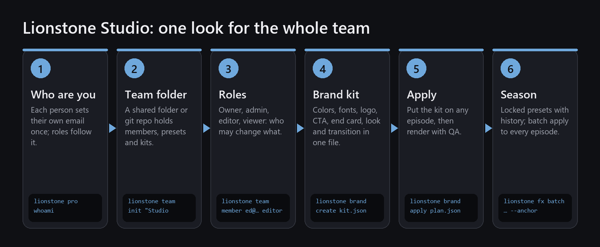

# One look for the whole team: brand kits and roles

The team tools sit on top of the [creative features](pro.md) and are free for any number of people. They are what a
team needs to keep every editor and every episode on brand: a shared workspace, roles, brand kits,
versioned and locked presets, and batch apply. Everything below is a real run with two team members
on the same sample episode.



---

## Step 1 — Install and say who you are

Each person installs Lionstone as in the [creative features guide](pro.md#step-1--install). Then each person
tells Lionstone who they are, once per computer — roles follow this email:

```bash
lionstone whoami owner@studionotes.example
# You work as owner@studionotes.example (from this computer).
```

On Ed's computer:

```bash
lionstone whoami ed@studionotes.example
# You work as ed@studionotes.example (from this computer).
```

Render servers and CI: set `LIONSTONE_USER` to an email.

## Step 2 — Create the team workspace

The workspace is a plain folder: a network drive, a synced folder or a git repository. Nothing is
uploaded anywhere. Everyone points `LIONSTONE_STUDIO_DIR` at it:

```bash
# Windows:      $env:LIONSTONE_STUDIO_DIR = 'S:\studio-notes'
# macOS/Linux:  export LIONSTONE_STUDIO_DIR=~/Shared/studio-notes
lionstone team init "Studio Notes"
```

```text
team 'Studio Notes' (studio-notes) created in S:\studio-notes; owner owner@studionotes.example
```

## Step 3 — Add people and roles

```bash
lionstone team member ed@studionotes.example editor
lionstone team show
```

| Role | Can |
|---|---|
| viewer | use team presets and brand kits |
| editor | + save presets and kits, apply kits |
| admin | + change locked presets and kits, manage members |
| owner | + appoint admins (whoever ran `team init`) |

The same `team show` on two computers:

```text
owner's computer:  "you": "owner",  "as": "owner@studionotes.example"
Ed's computer:     "you": "editor", "as": "ed@studionotes.example"
```

And when Ed tries something only admins may do:

```text
$ lionstone team member x@studionotes.example viewer
🔒 ed@studionotes.example can't manage members of Studio Notes
```

> Roles organise the team's work. Anyone who can write to the shared folder can edit `team.json`, so
> use the folder's own permissions for real access control.

## Step 4 — Write the brand kit

One JSON file holds your brand: colors, licensed fonts, logo, call to action, end card, signature
look and default transition.

```json
{
  "name": "Studio Notes",
  "colors": {"primary": "#121212", "accent": "#E8B04B", "text": "#FFFFFF", "background": "#000000"},
  "fonts": {"title": {"path": "fonts/Brand-Bold.ttf", "license": "SIL OFL 1.1"}},
  "cta": {"text": "Subscribe", "subtext": "New episode every Tuesday"},
  "end_card": {"title": "Studio Notes", "subtitle": "studionotes.example"},
  "transition": "lionstone.dip-to-black",
  "look": {"preset": "lionstone.look-warm-cinema", "intensity": 0.5},
  "locked": ["lionstone.look-warm-cinema"]
}
```

```bash
lionstone brand create kit.json --team
# saved kit 'Studio Notes' revision 1
```

Fonts and logos must state their licence; missing files are reported when the kit is applied.
`locked` presets can only be changed by admins.

## Step 5 — Apply it to an episode

After the usual `lionstone edit` ([free guide](free.md#step-3--edit-with-one-command)):

```bash
lionstone brand apply ep12_lionstone/plan.json "Studio Notes"
lionstone fx render ep12_lionstone/plan.json
```

```text
applied 'Studio Notes' (team:studio-notes). Render: lionstone fx render ep12_lionstone/plan.json
```

The kit placed five things, each marked as coming from the brand kit:

```text
brand-kit  look-warm-cinema  global  brand look (Studio Notes, locked)
brand-kit  cta               output  brand CTA (Studio Notes)
brand-kit  end-card          output  brand end card (Studio Notes)
brand-kit  dip-to-black      join    brand transition at topic change (Studio Notes)
brand-kit  dip-to-black      join    brand transition at topic change (Studio Notes)
```


## Step 6 — A whole season

**Team presets with history.** Save a preset for everyone, lock it, and see who changed what:

```bash
lionstone preset save "Notes Grain" --from film-grain --param intensity=0.2 --team --locked
lionstone preset history team.notes-grain --team
lionstone preset revert team.notes-grain 1 --team
```

```text
r1   2026-10-22T10:57:53+00:00  owner@studionotes.example      fbcc1e27d7dd
```

**Batch apply** the same preset to every episode in one run:

```bash
lionstone fx batch dip-to-black season/ep10/plan.json season/ep11/plan.json --anchor all-joins
```

```text
season/ep10/plan.json: +11 × Dip to Black
season/ep11/plan.json: +11 × Dip to Black
```

→ [Creative features overview](../PRO.md)
