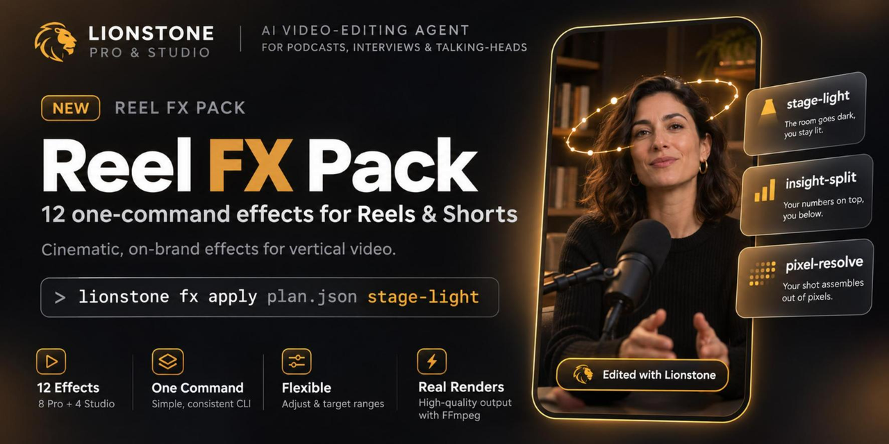
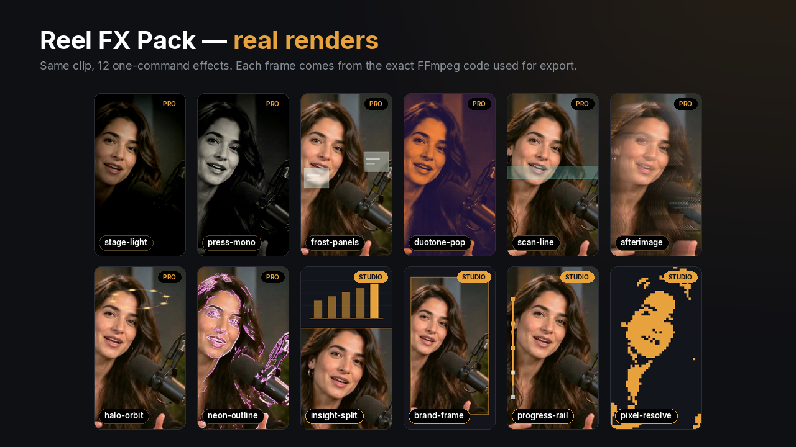
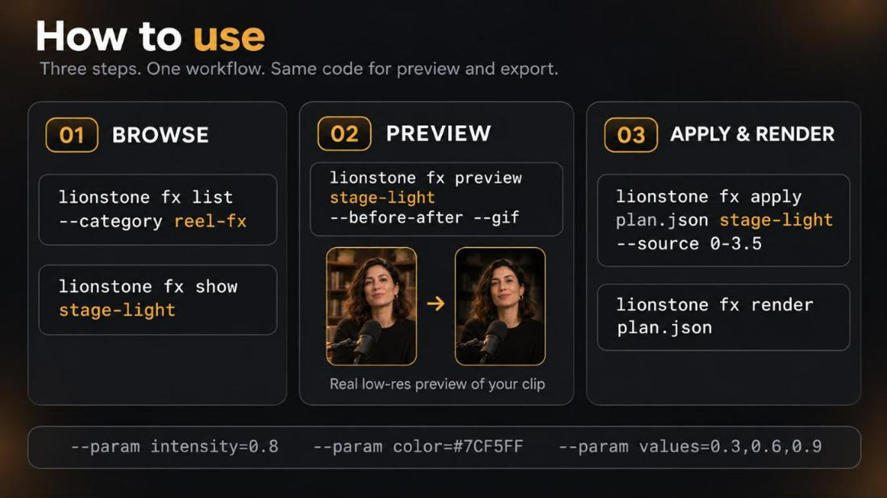
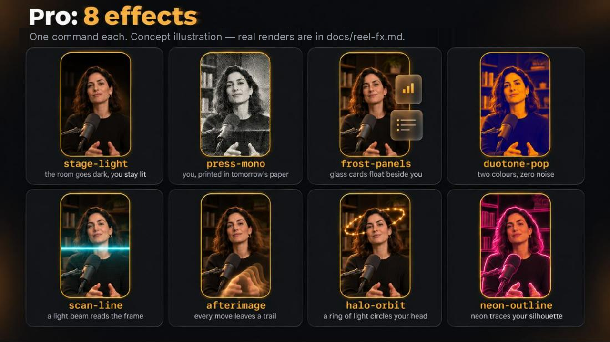
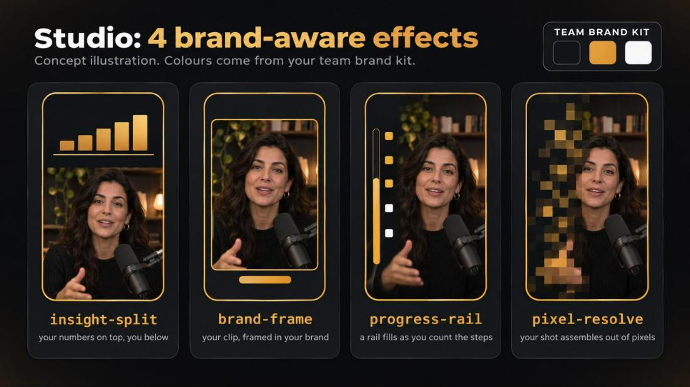
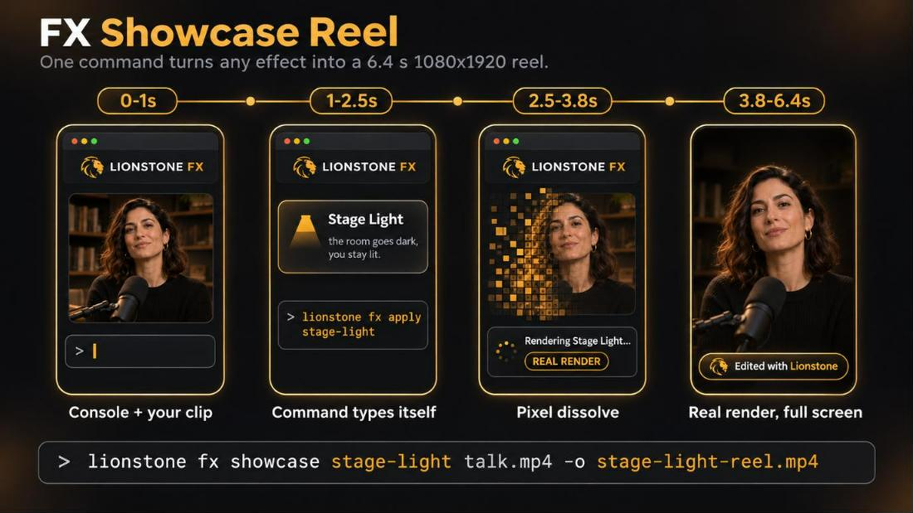
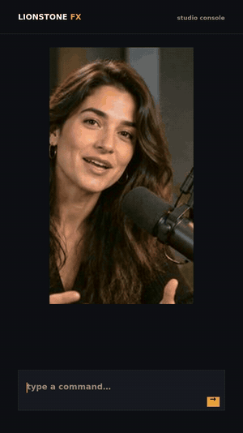

# Reel FX Pack — 12 one-command effects for Reels & Shorts



Reel FX turns one talking-head clip into a series. Each effect is a single command, works
on 9:16, 1:1 and 16:9, and renders with the same FFmpeg code in the preview and the export.

* **8 creative effects** (catalog label *pro*) — looks and overlays for hooks, quotes and highlights.
* **4 brand-aware effects** (catalog label *studio*) — layouts whose colours come from your brand kit.
* **FX Showcase Reel** — `lionstone fx showcase` turns any effect into a 6.4 s vertical reel.

Like everything in Lionstone, the pack is free and open source (Apache-2.0): no key, no
watermark, no upload. *Pro* and *Studio* are only catalog labels.

Every name, look and parameter is original to Lionstone. Nothing is bundled from third
parties: no stock overlays, LUTs, fonts or footage — just FFmpeg filter math
(`license.source = "lionstone-original"`).



*Above: real Lionstone renders of one clip. The other images on this page are concept
illustrations of the same effects (made for the docs); use `lionstone fx preview` to see
the real result on your own footage.*

## Quick start



```bash
# 1. browse the pack (catalog category "reel-fx")
lionstone fx list --category reel-fx
lionstone fx show stage-light

# 2. real low-res preview — the same builder as the export
lionstone fx preview stage-light --before-after --gif
lionstone fx preview halo-orbit --input talk.mp4 --start 12 --param dots=6

# 3. apply to the whole video, a segment or a time range, then render
lionstone fx apply plan.json stage-light --param intensity=0.8
lionstone fx apply plan.json scan-line --source 12.0-16.5 --param color=#7CF5FF
lionstone fx render plan.json
```

Parameters are validated (type, range, colour format); invalid values are rejected, never
guessed. All effects ramp or appear only inside their window — outside it the clip is
untouched. Layout effects (`insight-split`, `brand-frame`) swap the full frame only inside their window.

**Effect budget.** Like every Lionstone effect, Reel FX respects the compile budget: at
most one main + one helper effect at the same moment, and never two high-cost effects
overlapping (`pixel-resolve` is high-cost). Pair a Reel FX effect with a look
(`look-punchy-social`) and captions rather than stacking three effects.

## Creative effects (label: pro)



| Effect | Promise | Parameters (default) | Cost |
|---|---|---|---|
| `stage-light` | the room goes dark, you stay lit | `intensity` 0.7 · `x` 0.5 · `y` 0.36 · `size` 0.5 | low |
| `press-mono` | you, printed in tomorrow's paper | `intensity` 0.8 · `grain` 0.4 · `paper` #F2EAD8 | low |
| `frost-panels` | glass cards float beside you | `panels` 2 (1–3) · `frost` 0.6 · `tint` #FFFFFF | medium |
| `duotone-pop` | two colours, zero noise | `intensity` 1.0 · `shadow` #1A1238 · `highlight` #FF8A3D | low |
| `scan-line` | a light beam reads the frame | `intensity` 0.7 · `speed` 0.6 sweeps/s (0.2–2) · `color` #7CF5FF | medium |
| `afterimage` | every move leaves a trail | `intensity` 0.8 · `decay` 0.92 (0.5–0.99) | medium |
| `halo-orbit` | a ring of light circles your head | `color` #FFD27A · `x` 0.5 · `y` 0.2 · `radius` 0.3 · `dots` 8 (3–12) · `speed` 0.3 rev/s | medium |
| `neon-outline` | neon traces your silhouette | `intensity` 0.75 · `detail` 0.5 · `color` #FF4FD8 | medium |

`x`, `y` and `radius` are fractions of the frame (0 = left/top, 1 = right/bottom).

### stage-light — *the room goes dark, you stay lit*
A soft pool of light stays on the speaker while the rest of the frame falls into shadow:
an eased vignette centred on `x`/`y`, plus a gentle exposure and saturation drop around it.
It ramps in over 0.5 s and out over 0.35 s, so it reads as lights dimming, not a cut.

* **Use it for:** podcast hooks, the one sentence that matters, emotional interview answers, a reveal before a product shot.
* **Recommended:** `intensity` 0.6–0.8; set `y` to the speaker's eye line (≈ 0.3–0.4 in a 9:16 crop); `size` 0.6+ for wide shots.
* **Pro tip:** apply it to a 3–5 s source range on the hook line only (`--source 2.1-6.0`) — darkness that lasts the whole clip stops being an event.

### press-mono — *you, printed in tomorrow's paper*
Documentary black-and-white with crushed blacks, highlights tinted to the `paper` colour,
ink-like sharpening, print grain and a light vignette.

* **Use it for:** quotes, founder stories, investigative or historical topics, "breaking news" style hooks.
* **Recommended:** `intensity` 0.7–0.9, `grain` 0.3–0.5. A warmer `paper` (#EFE2C8) feels archival; #FFFFFF feels modern.
* **Pro tip:** combine with a text preset such as `stat-emphasis` or `word-pop` for a stamped headline.

### frost-panels — *glass cards float beside you*
Up to three frosted-glass cards — blurred, lifted and tinted copies of the frame behind
them, with an outline and two placeholder lines — appear one after another (0.12 s apart)
beside the speaker. On 9:16 they sit left/right of a centred speaker; on 16:9 they stack in
the left column.

* **Use it for:** 2–3 takeaways, feature lists, "three things you need" tutorials.
* **Recommended:** `panels` 2 for a comparison, 3 for a list; `frost` 0.5–0.7. Use `tint` with a brand colour for coloured glass.
* **Pro tip:** put your words on the cards with `pin-label` or `phrase-build` text presets, keep each to 2–3 words.

### duotone-pop — *two colours, zero noise*
Maps the shot onto two colours: `shadow` for the darks, `highlight` for the lights, with a
contrast curve for a bold poster look. `intensity` < 1 blends it with the original.

* **Use it for:** promos, intros and outros, thumbnails, brand series.
* **Recommended:** choose colours with strong brightness contrast (dark shadow, light highlight). `intensity` 0.6 gives a tinted, more natural version.
* **Pro tip:** use it for the first 1–2 seconds, then cut to the natural shot — the change itself is the hook.

### scan-line — *a light beam reads the frame*
A crisp glowing line with a soft trailing band sweeps from top to bottom on repeat, `speed`
times per second, inside the window.

* **Use it for:** AI and tech explainers, "let's analyse this" moments, product feature reveals, before/after.
* **Recommended:** `speed` 0.5–0.8 for one or two calm passes; cyan (#7CF5FF) or your brand colour.
* **Pro tip:** set the window to exactly one sweep (window length = 1 / `speed`) for a single, deliberate scan.

### afterimage — *every move leaves a trail*
Bright parts of the image decay slowly (`decay`), so hands, head turns and products leave
luminous trails; the trail layer is lightened over the original.

* **Use it for:** energetic hooks, gestures, music and entertainment clips, product spins.
* **Recommended:** `decay` 0.88–0.95. Higher = longer trails.
* **Pro tip:** trails come from bright areas — it shines with a lit subject and a darker background, and does nothing on a still frame.

### halo-orbit — *a ring of light circles your head*
Glowing dots on a tilted elliptical ring rotate around the point `x`/`y`. The ring is drawn
once and rotated, so it stays light to render.

* **Use it for:** "big idea" moments, thought leadership, creative education, intros.
* **Recommended:** `y` just above the eyes (0.15–0.25 in 9:16), `radius` 0.25–0.35, `dots` 6–8, `speed` 0.2–0.4.
* **Pro tip:** the ring is drawn in front of the speaker; place it above the head line on tight close-ups so it doesn't cross the eyes.

### neon-outline — *neon traces your silhouette*
Edge detection tinted to `color`, thickened and glowed, then screened over the shot.
`detail` sets how many edges appear (higher = more lines).

* **Use it for:** tech and gaming topics, music, stylised promos, transitions between sections.
* **Recommended:** `detail` 0.3–0.5 on busy rooms, 0.6+ on clean backdrops.
* **Pro tip:** a clean background makes the silhouette the hero; busy shelves create many competing lines.

## Brand-aware effects (label: studio)



These effects take their colours as parameters, so a brand kit can set them once for the
whole team. Defaults are Lionstone ink (#14161C) and gold (#E8A33D).

| Effect | Promise | Parameters (default) | Cost |
|---|---|---|---|
| `insight-split` | your numbers on top, you below | `split` 0.38 (0.25–0.5) · `bars` 5 (2–7) · `values` [] · `bg` · `accent` | medium |
| `brand-frame` | your clip, framed in your brand | `inset` 0.84 (0.7–0.95) · `bg` · `accent` | low |
| `progress-rail` | a rail fills as you count the steps | `steps` 5 (2–8) · `side` left/right/top · `track` #FFFFFF · `accent` | low |
| `pixel-resolve` | your shot assembles out of pixels | `duration` 1.2 s (0.4–3) · `tone_a` · `tone_b` | high |

### insight-split — *your numbers on top, you below*
The top `split` of the frame becomes a brand panel with a light grid; bars rise one by one
with an ease-out (0.18 s apart) and the last bar is drawn in full accent. The speaker moves
to the lower part (the crop keeps the upper-middle of the frame, where faces usually are).

* **Use it for:** results, growth numbers, before/after metrics, market data, real-estate prices.
* **Recommended:** pass real data as fractions: `--param values=0.3,0.55,0.9`; `bars` follows the number of values (max 7).
* **Pro tip:** add a `counter-up` text preset on top of the panel to show the actual number.

### brand-frame — *your clip, framed in your brand*
The clip is scaled to `inset` and placed on the brand background inside an accent border,
with a small accent tab underneath — a consistent "episode card" look for a whole channel.

* **Use it for:** series formats, quotes, guest introductions, client reels with fixed branding.
* **Recommended:** `inset` 0.8–0.88 leaves room for a title above and captions below.
* **Pro tip:** apply it to the whole video in a team preset so every editor ships the same framing.

### progress-rail — *a rail fills as you count the steps*
A rail fills across the window (eased) on the left, right or top edge, and `steps` dots
light up from track colour to accent as the fill passes them.

* **Use it for:** tutorials, listicles, "step 3 of 5" content, recipes, checklists.
* **Recommended:** match `steps` to the number of points you make; set the window to the list section only.
* **Pro tip:** `side=top` works well with captions at the bottom; `left` when the speaker is right of centre.

### pixel-resolve — *your shot assembles out of pixels*
The signature reveal: the frame starts as a coarse two-tone dither in `tone_a`/`tone_b`
and resolves through five pixel stages (40 → 4 px blocks at 1080p) into the clean shot over
`duration` seconds at the start of the window. The rest of the window is clean.

* **Use it for:** openers, reveals, scene changes, brand intros, the moment after a question.
* **Recommended:** `duration` 0.8–1.5 s; brand dark + brand accent tones.
* **Pro tip:** apply it to a 1–2 s window right after a cut (`--source 0-1.5`) to make every episode start the same way.

## FX Showcase Reel





*Right: the real output of `lionstone fx showcase stage-light` (GIF, reduced).*

One command turns any effect (or look) into a 6.4 s, 1080×1920, 30 fps vertical reel —
the "one command, one clip, one effect" format, built with Lionstone's own console design:

| Time | Beat |
|---|---|
| 0.00–1.00 s | Lionstone console, the clip in a card, blinking cursor |
| 1.00–2.50 s | `lionstone fx apply <effect>` types itself; a card shows the effect name and its promise |
| 2.50–3.80 s | "Rendering <Effect>… REAL RENDER" while the clip dissolves through the gold/ink `pixel-resolve` dither |
| 3.80–6.40 s | the real render scales up to full screen; "Edited with Lionstone" pill; hold |

```bash
lionstone fx showcase stage-light talk.mp4 -o stage-light-reel.mp4
lionstone fx showcase halo-orbit talk.mp4 --start 12 --param dots=6
```

The "after" clip is rendered with the very same builder as the export, so the reel never
shows a mock result. Keep the input clip identical across posts — the same "before" is what
makes a numbered series comparable.

## Recipes

| Goal | Command |
|---|---|
| Hook on the first line | `lionstone fx apply plan.json stage-light --source 0.0-3.5 --param intensity=0.75` |
| Quote card | `lionstone fx apply plan.json press-mono --source 41.2-47.0` + `lionstone fx text plan.json word-pop --text "…" --at 1` |
| Three takeaways | `lionstone fx apply plan.json frost-panels --source 20-32 --param panels=3` |
| Data moment | `lionstone fx apply plan.json insight-split --source 55-63 --param values=0.2,0.45,0.9` |
| Tutorial steps | `lionstone fx apply plan.json progress-rail --source 30-90 --param steps=5` |
| Branded opener | `lionstone fx apply plan.json pixel-resolve --source 0-1.6` |

## Limits (honest)

* `frost-panels` and `insight-split` use fixed, face-safe positions for a centred speaker; they don't track faces.
* `halo-orbit` is drawn in front of the speaker (no depth sorting).
* `afterimage` needs movement and bright areas; a static frame shows no trails.
* Brand colours are parameters; brand kits set them, they are not read from the video.
* All effects are FFmpeg-only; no Remotion is needed.

## For developers

* Renderers: `src/lionstone/pro/features/renderers/reel_fx.py` (registered on import via `renderers/__init__.py`).
* Catalog: `src/lionstone/pro/features/presets/reelfx.json`, generated by `python tools/gen_reel_presets.py`.
* Showcase: `src/lionstone/pro/features/showcase.py` (`lionstone fx showcase`).
* Tests: `tests/pro/test_reel_fx.py` (every effect renders on 9:16 and 16:9; the showcase renders 1080×1920). All ready presets are also covered by `tests/pro/test_fx_render.py`.
